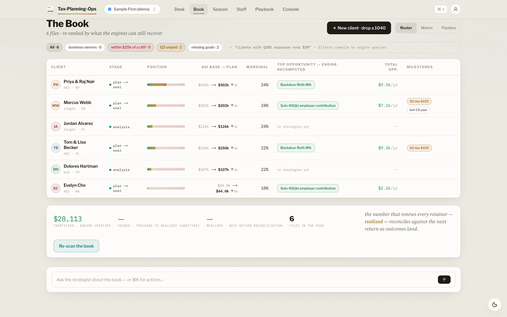
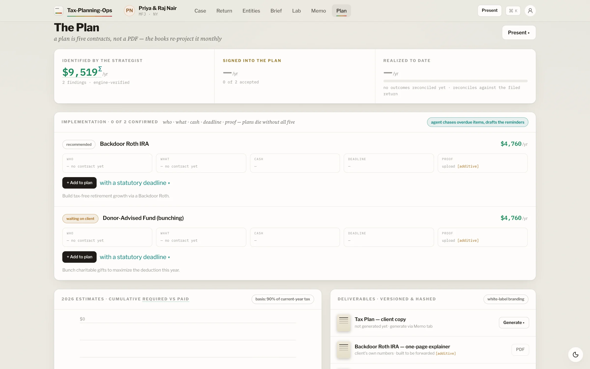
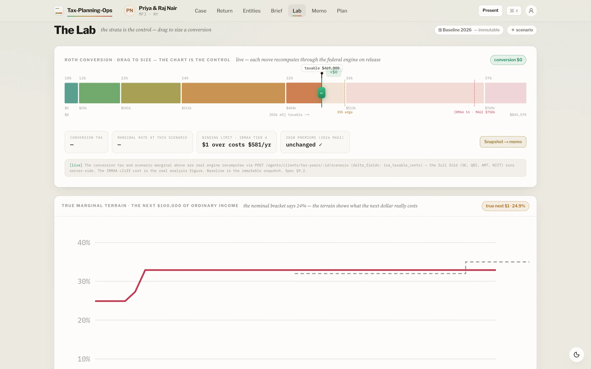
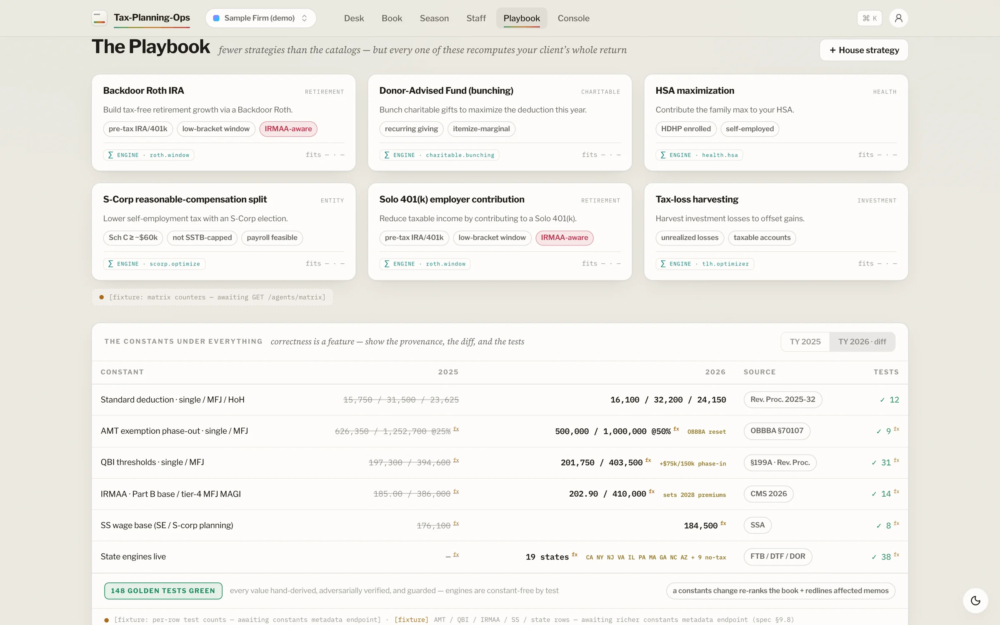
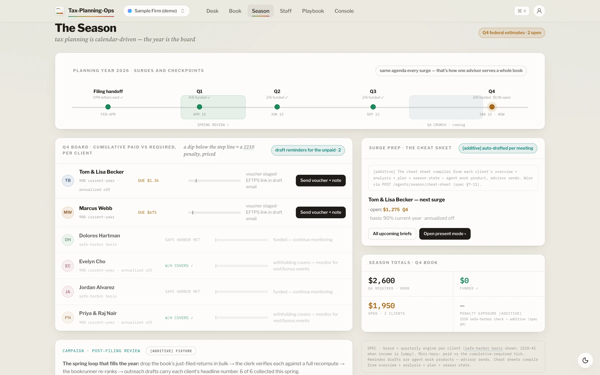
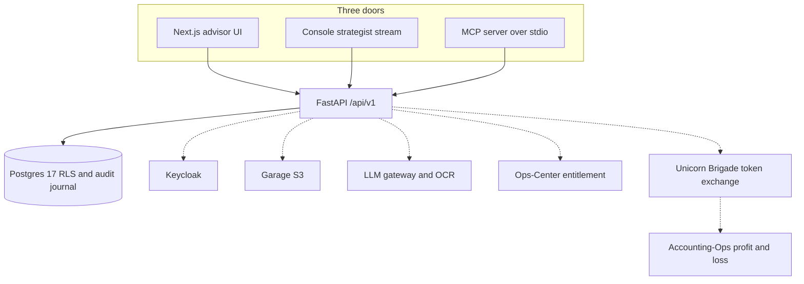

<h1 align="center">Tax-Planning-Ops</h1>

<p align="center">
  Self-hosted tax planning for CPA firms and advisors.<br>
  Project the household and its businesses, price the strategies, and schedule the quarterlies.
</p>

<p align="center">
  <a href="LICENSE"></a>
  
  
  
  
  
  
</p>

<p align="center">
  <a href="#quick-start">Quick start</a> ·
  <a href="#feature-tour">Features</a> ·
  <a href="#built-for-agents">Agents</a> ·
  <a href="#architecture">Architecture</a> ·
  <a href="#part-of-unicorn-commander">Suite</a>
</p>

<p align="center">
  
</p>

## What is Tax-Planning-Ops?

Tax-Planning-Ops is the planning desk for a firm that already has clients, entities, and a ledger. An advisor keeps a book of clients, confirms a filed return, and projects the current year against the next one — marginal rate, effective rate, and the assumptions the engine had to make. Strategies are priced, quarterly estimates are scheduled, and a plan document is stored for the client.

Agents draft the memo, the scenario, and the book-wide scan. A person signs the memo and chooses what goes on the plan. The app is self-hosted, and it is one module of [Unicorn Commander](https://unicorncommander.ai): the same Keycloak login as the rest of the suite, and an optional read of profit and loss from [Accounting-Ops](https://github.com/Unicorn-Commander/Accounting-Ops) when a business entity is linked.

> Planning estimate only. Not a filed tax return and not tax advice. Figures are projections based on advisor-entered assumptions and editable bracket tables.

That sentence is the disclaimer the plan document carries (`backend/app/engines/plan_pdf.py`). Return preparation stays in the firm's prep software. The books stay in Accounting-Ops. This app plans.

## Highlights

- **One household, including the businesses.** A client tax year can carry Schedule C, partnership K-1s, S corporation K-1s, and rentals (`backend/app/engines/passthrough.py`), plus a separate C corporation view (Form 1120, accumulated earnings tax, QSBS). Qualified business income is computed in the same projection as the 1040.
- **Current year beside next year.** Federal brackets and standard deductions are seeded for 2025 (Rev. Proc. 2024-40, including the OBBBA standard deduction) and 2026 (Rev. Proc. 2025-32). Advisors can edit bracket sets per year. The 1040 engine returns marginal rate, effective rate, and an assumptions list when it had to guess (for example, treating an unsplit capital gain as long-term).
- **Federal stack in one pass.** Ordinary tax, preferential long-term gains, NIIT, additional Medicare, AMT, the child tax credit, taxable Social Security, self-employment tax, and QBI. State income tax is modeled for all 50 states and the District of Columbia. IRMAA is part of the Roth conversion search.
- **Strategy library with an explicit ROI method.** Each library row is `amount × effective rate`, `amount × custom rate`, or a manual dollar amount. Adding a strategy to a plan is a separate call from listing the catalog.
- **Quarterly estimates with safe harbor.** The engine picks the smaller of 90% of the projected current-year tax, 100% of prior-year tax, and (when prior-year AGI is over the threshold) 110% of prior-year tax, then rolls an unpaid quarter forward. Even and annualized methods are both in the engine.
- **Draft, then sign.** The plan proposer scores opportunities and writes no client strategy. The strategist authors a memo. `sign_memo` seals a content hash onto the audit journal. The book scanner only ranks; it does not write.
- **A journal a later reader can check.** Every mutation is appended to a per-workspace hash chain (SHA-256 over the previous hash plus the event, actor, aggregate, timestamp, and payload). The runtime database role may `SELECT` and `INSERT` on that table, and the migration does not grant `UPDATE` or `DELETE`. `GET /api/v1/lifecycle/audit/verify` recomputes the chain.
- **Workspace isolation in Postgres.** One database. Every tenant table has row-level security forced on. The API connects as `tax_planning_ops_app` (`NOBYPASSRLS`) and sets `app.current_workspace` for the transaction. Migrations run as `tax_planning_ops_owner`.

## Feature tour

### The client book

<p align="center">
  
</p>

The book is the firm's roster. It loads clients, a book-wide scan ranked by the backend, each client's overview, and a clients-by-strategy matrix whose cells are engine-summed savings. A realized rollup shows planned amounts against amounts the firm has reconciled. The screenshot is the built-in **Sample Firm (demo)** workspace: six example clients and six library strategies, with every snapshot, ROI, and safe-harbor figure produced by the engine.

Load it from **Settings → Demo / sample data**. The demo workspace is separate from a firm's real workspaces. Reset clears and re-seeds only that workspace.

### A client's tax plan

<p align="center">
  
</p>

The plan is the working file for one client: strategies with engine-computed savings, implementation tasks (who, what, cash, deadline, proof), and the quarterly schedule. Deadlines resolve from a catalog of 15 federal dates (estimated-tax quarters, retirement contributions, the S corporation election, the extension, and others), each with a citation. Realized outcomes are recorded against the plan when the work is done.

Generating a plan document assembles branding, the current-year and next-year figures, the strategies, the quarterlies, and the disclaimer. When `PDF_SERVICE_URL` is set, that service renders the bytes. When it is empty, the API stores the canonical JSON payload and its hash. Either way the row is versioned.

### The scenario lab

<p align="center">
  
</p>

The lab recomputes through the same engine the rest of the app uses. Dragging a Roth conversion calls `POST /api/v1/agents/clients/tax-years/{id}/scenario` and shows the tax delta. The effective-marginal curve is an EMR sweep. The crossover chart is the Roth optimizer: a recommended conversion, its tax cost, and the IRMAA warning when the search hits a cliff. The baseline row is the stored snapshot. Scenario runs do not overwrite it.

`GET /api/v1/clients/tax-years/{id}/analysis` also rolls the return forward (default horizon five years), inflation-indexing the brackets the statute indexes and holding NIIT and additional Medicare thresholds fixed unless a seeded year config exists.

### The strategy library

<p align="center">
  
</p>

The playbook lists the workspace strategy catalog and the bracket sets for each seeded year, with a diff between years. An advisor with `taxplan:admin` can upsert library rows and replace a bracket set. Categories in the demo seed are retirement, charitable, entity, health, and investment. The catalog is data, not a hard-coded list: a firm adds the plays it actually uses.

### Quarterly estimates

<p align="center">
  
</p>

The season board aggregates each client's quarterly rows: required payment, amount paid, unpaid roll-forward, and the safe-harbor basis the engine chose. The same rows sit on the client's plan. Computing them is `POST /api/v1/quarterly/{plan_tax_year_id}/compute`, also exposed to agents as `compute_quarterly`.

A Form 2210 underpayment function lives in the engine package and has tests. The season board does not call it yet.

## Built for agents

Three doors call one API. The advisor UI, the in-app console, and the MCP server all hit `/api/v1`. The console streams a strategist run over server-sent events (`POST /api/v1/agents/clients/tax-years/{id}/strategist/stream`): plan steps, the engine calls, the findings, and the memo. Dollar figures are computed on the server. If the language model is not configured, structured opportunities still return and the narrative is omitted.

The MCP server speaks Model Context Protocol over **stdio**. It is a thin client: `tools.json` maps each tool to an existing route, and the server forwards `Authorization: Bearer` and `X-Workspace-Id`. Auth, entitlement, row-level security, and scopes are enforced by the API. The server computes no tax. `manifest.json` (version **0.2.0**) lists the same **31** tools for Unicorn Brigade to discover. Journal writes record which door the request came through (`gui`, `console`, `mcp`, or `api`). The MCP server sends `X-UC-Door: mcp`.

Scopes are `taxplan:advisor` for client work and `taxplan:admin` for the library, bracket sets, and branding. Admin includes advisor.

| Tool | What an agent uses it for |
|---|---|
| `create_client` | Open a client in the active workspace |
| `upload_return_document` | Attach a Form 1040 PDF to a tax year |
| `correct_extracted_field` / `confirm_return` | Fix a line, then lock the return into a snapshot |
| `create_tax_plan` / `add_client_strategy` | Open the next-year plan and attach a library strategy |
| `compute_quarterly` | Run the safe-harbor schedule |
| `generate_plan_pdf` | Store the plan document |
| `scan_book` | Rank the book. Read only |
| `run_strategist` / `sign_memo` | Draft the memo, then seal it |
| `recompute_scenario` / `emr_sweep` | Reprice a what-if and the marginal curve |
| `optimize_roth` / `optimize_scorp` | Bracket-fill a conversion, or search S corporation compensation |
| `list_statutory_deadlines` | Resolve the deadline catalog for a tax year |
| `read_journal` | Read the hash-chained audit tail |

The full map is [`mcp/tools.json`](mcp/tools.json). Run the server with the official Python `mcp` package installed (it is imported by `mcp/server.py` and is not pinned in `backend/requirements.in`):

```bash
python mcp/server.py
```

```json
{
  "mcpServers": {
    "tax-planning-ops": {
      "command": "python",
      "args": ["/path/to/Tax-Planning-Ops/mcp/server.py"],
      "env": {
        "TPO_API_URL": "http://localhost:8000/api/v1",
        "TPO_MCP_TOKEN": "<bearer-token>",
        "TPO_WORKSPACE_ID": "<workspace-uuid>"
      }
    }
  }
}
```

There is no A2A agent card in this repository. Brigade's connection here is the manifest plus, when you enable the Accounting-Ops read, an RFC 8693 token exchange at `BRIGADE_TOKEN_URL`.

The Staff screen reads `GET /api/v1/agents/registry`. The roster is five capabilities, and each one's status comes from the journal:

| Capability | Kind | What it does |
|---|---|---|
| Strategist | agent | Findings, memo, Roth and S corporation search, EMR sweep |
| Book Scanner | engine | Ranks the book. Writes nothing, so it stays idle in the registry |
| Plan Proposer | agent | Prioritized proposal. Applying it is a separate advisor action |
| Intake / OCR | service | 1040 upload and confirmation |
| Quarterly | engine | The estimated-payment schedule |

With `OCR_QWENVL_ENABLED` off, an upload still creates the canonical 1040 field set with status `missing`, and the advisor keys the lines. Confirming requires a value, or an explicit acknowledgement to compute anyway.

## Quick start

You can run the API and the UI on a laptop without Keycloak. The suite compose file is for a host that already has Traefik and a Keycloak realm. Use the laptop path first.

### Database

The API expects Postgres 17, the same image as CI and `deploy/docker-compose.yml`.

```bash
docker run -d --name tax-planning-ops-postgres \
  -e POSTGRES_USER=tax_planning_ops_owner \
  -e POSTGRES_PASSWORD=<owner-password> \
  -e POSTGRES_DB=tax_planning_ops \
  -p 55432:5432 \
  postgres:17-alpine
```

Wait until `pg_isready` succeeds:

```bash
docker exec tax-planning-ops-postgres pg_isready -U tax_planning_ops_owner -d tax_planning_ops
```

Port **55432** matches the default `DATABASE_URL` in `backend/app/core/config.py` and the CI workflow.

### Suite deploy

`deploy/docker-compose.yml` builds the API and the Next.js app, runs migrations on startup (`python -m app.db.bootstrap` in the image entrypoint), and starts Postgres 17 and Redis 7. The API code does not open a Redis connection. The compose file joins external Docker networks named `web` and `unicorn-network`, publishes no host ports, and expects Traefik to route `DOMAIN` and `API_DOMAIN`.

```bash
cd deploy
cp .env.example .env
docker compose --env-file .env up -d --build
```

Before that command will serve traffic you need:

- The two external networks. `docker compose` fails if they are missing.
- A Keycloak client `tax-planning-ops` in realm `uchub`, with access tokens that carry audience `tax-planning-ops` and the scopes `taxplan:advisor` and `taxplan:admin`. The client setup is in `docs/DEPLOY-KEYCLOAK.md`.
- `ENVIRONMENT=production` in `.env`. The API maps that to `ENV=prod`, which turns off `/docs` and refuses `STANDALONE_MODE`.

The backend health check requests `http://localhost:8000/api/v1/livez` inside the container. That route is unauthenticated and returns `{"ok":true}`.

## Run from source

Python 3.12 and Node.js 22 match the Dockerfiles and CI.

```bash
cd backend
python3 -m venv .venv
./.venv/bin/pip install -r requirements-dev.txt

export MIGRATION_DATABASE_URL=postgresql+asyncpg://tax_planning_ops_owner:<owner-password>@localhost:55432/tax_planning_ops
export RUNTIME_DB_PASSWORD=<runtime-password>
export DATABASE_URL=postgresql+asyncpg://tax_planning_ops_app:<runtime-password>@localhost:55432/tax_planning_ops

./.venv/bin/python -m app.db.bootstrap
```

Bootstrap creates the `NOBYPASSRLS` role if needed, sets its password from `RUNTIME_DB_PASSWORD`, and runs `alembic upgrade head`.

Start the API in standalone mode. Any bearer token is accepted and treated as user `standalone-user` with advisor and admin scope. The first request that opens a tenant session provisions that workspace. Standalone mode raises at startup when `ENV=prod`.

```bash
ENV=dev STANDALONE_MODE=true ./.venv/bin/uvicorn app.main:app --host 127.0.0.1 --port 8000
```

```bash
curl -fsS http://127.0.0.1:8000/api/v1/livez
```

In another shell, start the UI. `NEXT_PUBLIC_API_URL` defaults to `http://localhost:8000/api/v1`. `NEXT_PUBLIC_DEV_AUTOLOGIN=1` stores a local dev token so the screens render against standalone mode.

```bash
cd frontend
npm ci
NEXT_PUBLIC_DEV_AUTOLOGIN=1 npm run dev
```

Open `http://localhost:3000`. The root route sends a firm posture to the desk. Go to **Settings**, load sample data, and switch to **Sample Firm (demo)**.

To exercise real RS256 verification instead of standalone mode, the repo includes a local JWKS stand-in. It is a development tool. Do not point a production issuer at it.

```bash
cd backend
./.venv/bin/python scripts/dev_oidc.py serve --port 8765
./.venv/bin/python scripts/dev_oidc.py mint \
  --workspace <workspace-uuid> \
  --scopes "taxplan:advisor taxplan:admin" \
  --issuer http://localhost:8765
```

Run the API with `STANDALONE_MODE` unset, `KEYCLOAK_ISSUER=http://localhost:8765`, and the minted token as the bearer. The script answers every GET with the JWKS document, which is what the API fetches at `{issuer}/protocol/openid-connect/certs`.

## Configuration

Names only. Set values in `deploy/.env` or the process environment. `backend/app/core/config.py` reads the API variables. The Next.js build bakes the `NEXT_PUBLIC_*` variables in. The MCP process reads the `TPO_*` variables.

| Variable | Meaning |
|---|---|
| `ENVIRONMENT` | Compose value. `production` becomes API `ENV=prod`. `development` becomes `dev`. |
| `DOMAIN` | Hostname Traefik uses for the web app. |
| `API_DOMAIN` | Hostname Traefik uses for the API. |
| `POSTGRES_DB` | Database name. Compose defaults to `tax_planning_ops`. |
| `OWNER_DB_PASSWORD` | Password for role `tax_planning_ops_owner`. Compose also uses it as the Postgres superuser password. |
| `RUNTIME_DB_PASSWORD` | Password bootstrap assigns to role `tax_planning_ops_app`. |
| `DATABASE_URL` | Async SQLAlchemy URL for the app role. |
| `MIGRATION_DATABASE_URL` | Async URL for the owner role. Bootstrap and Alembic use it. |
| `REDIS_PASSWORD` | Required by the Redis service in the compose file. The API does not read it. |
| `STANDALONE_MODE` | Dev-only. Accepts any bearer and skips JWKS. Refused when `ENV=prod`. |
| `KEYCLOAK_ISSUER` | Issuer claim the API requires. Default realm is `uchub` on the public Unicorn Commander auth host. |
| `KEYCLOAK_CLIENT_ID` | Audience and OAuth client. Default `tax-planning-ops`. |
| `KEYCLOAK_CLIENT_SECRET` | Confidential-client secret for the browser login and the service-account mint. |
| `KEYCLOAK_URL` | Keycloak base URL baked into the frontend image. |
| `KEYCLOAK_REALM` | Realm baked into the frontend image. Default `uchub`. |
| `ENTITLEMENT_CHECK_ENABLED` | When true, each request asks Ops-Center whether the workspace has the `tax-planning-ops` entitlement. Default off, and the request is allowed. |
| `CONTROL_PLANE_BASE_URL` | Ops-Center base URL used by that check. |
| `CONTROL_PLANE_TOKEN` | Bearer token for the entitlement request. |
| `GARAGE_ENDPOINT` | S3 endpoint for return PDFs and plan documents. |
| `GARAGE_ACCESS_KEY` / `GARAGE_SECRET_KEY` | When either is empty, the API keeps the object key and does not store the bytes. |
| `GARAGE_BUCKET` | Bucket name. |
| `OCR_QWENVL_ENABLED` | When false, uploads still open the canonical 1040 fields for hand entry. |
| `LLM_GATEWAY_URL` / `LLM_API_KEY` | OpenAI-compatible gateway for OCR structuring and the planning narrative. |
| `OCR_SERVICE_URL` | Optional traditional OCR service. Page text is then structured by the LLM. |
| `PDF_SERVICE_URL` | Optional renderer. Empty means the stored plan document is the canonical JSON payload. |
| `ACCOUNTING_OPS_ENABLED` | Turns on the profit-and-loss read for a linked business entity. Default off. The sync route returns 503 while it is off. |
| `ACCOUNTING_OPS_URL` | Accounting-Ops base URL. |
| `ACCOUNTING_OPS_AUDIENCE` | Audience requested from the Brigade token exchange. |
| `BRIGADE_TOKEN_URL` | RFC 8693 token endpoint. When set, the API exchanges its Keycloak token before calling Accounting-Ops. |
| `NEXT_PUBLIC_API_URL` | API base the browser calls. Default `http://localhost:8000/api/v1`. |
| `NEXT_PUBLIC_DEV_AUTOLOGIN` | Set to `1` for local screens against standalone mode. |
| `TPO_API_URL` | API base the MCP server proxies to. |
| `TPO_MCP_TOKEN` | Bearer token the MCP server forwards. |
| `TPO_WORKSPACE_ID` | Workspace header the MCP server forwards. |

## Architecture



Dotted arrows are optional. With standalone mode, an empty Garage config, OCR disabled, entitlement checks off, and Accounting-Ops disabled, the API and Postgres are enough to load the demo firm.

- **Advisor UI.** Next.js 15.5 and React 19. The workbench covers the book, a client's plan, the lab, the playbook, the season board, the desk, the console, intake checklists, staff, and settings.
- **API.** FastAPI on Python 3.12. Seventy-three routes under `/api/v1`. Money is integer cents. OpenAPI is served at `/docs` unless `ENV=prod`.
- **Engines.** Twenty-one modules under `backend/app/engines/`. They are pure functions. The comprehensive return composes the 1040 with Social Security taxability, the child tax credit, AMT, QBI, and self-employment tax. State tax, IRMAA, quarterly estimates, the C corporation, charitable bunching, and the Roth and S corporation searches sit beside it.
- **Postgres 17.** Nineteen migration files under `backend/alembic/versions/`. CI fails the build unless there is a single Alembic head. The runtime role cannot bypass row-level security.
- **MCP server.** `mcp/server.py`, registry in `mcp/tools.json`, Brigade manifest in `mcp/manifest.json`.
- **Intake.** Seven entity types (individual, sole prop, partnership, S corporation, C corporation, several entities, and "not sure") and a document checklist per type at `/api/v1/intake`.

## Part of Unicorn Commander

| App | What it does |
|---|---|
| [Ops-Center](https://github.com/Unicorn-Commander/Ops-Center) | The control plane: tenants, billing, federation, API keys, model routing |
| [Unicorn-Brigade](https://github.com/Unicorn-Commander/Unicorn-Brigade) | The agent layer: agents, tools, memory, orchestration |
| [Unicorn-Stable](https://github.com/Unicorn-Commander/Unicorn-Stable) | Humans and agents in the same room: chat, voice, video |
| [Accounting-Ops](https://github.com/Unicorn-Commander/Accounting-Ops) | Agent-native accounting and books |
| [Contact-Ops](https://github.com/Unicorn-Commander/Contact-Ops) | The shared contact and identity graph |
| [Customer-Ops](https://github.com/Unicorn-Commander/Customer-Ops) | Customers, pipeline, quotes and outreach |
| [Email-Ops](https://github.com/Unicorn-Commander/Email-Ops) | Agent-drafted email with a human approval inbox |
| [Project-Ops](https://github.com/Unicorn-Commander/Project-Ops) | Projects, tasks, time and invoices |
| [Meeting-Ops](https://github.com/Unicorn-Commander/Meeting-Ops) | Recordings, transcripts, summaries and action items |
| [Knowledge-Ops](https://github.com/Unicorn-Commander/Knowledge-Ops) | The wiki and memory your agents ground on |
| [Security-Ops](https://github.com/Unicorn-Commander/Security-Ops) | Authorized security scanning with engagement and attestation gates |
| **[Tax-Planning-Ops](https://github.com/Unicorn-Commander/Tax-Planning-Ops)** | **Tax plans, scenarios and statutory deadlines** |
| [Brand-Ops](https://github.com/Unicorn-Commander/Brand-Ops) | Brand kits, marks, voices and rules |
| [Podcast-Ops](https://github.com/Unicorn-Commander/Podcast-Ops) | Episodes, audio QA and publishing |
| [UUDA](https://github.com/Unicorn-Commander/UUDA) | The device agent for your fleet |
| [fleet-map](https://github.com/Unicorn-Commander/fleet-map) | Fleet inventory and topology map |

Tax-Planning-Ops checks an optional Ops-Center entitlement, discovers its tools to Unicorn Brigade through `mcp/manifest.json`, exchanges a Brigade token when the Accounting-Ops read is on, and stores bytes in Garage when credentials are set. It signs users in with Keycloak. It does not call the other suite apps.

## Development

CI (`.github/workflows/ci.yml`) runs the backend checks on Python 3.12 against Postgres 17, then the frontend on Node 22.

```bash
cd backend
./.venv/bin/ruff check app tests scripts
./.venv/bin/mypy app
./.venv/bin/pytest
```

`pytest` collects the tests under `backend/tests` (45 modules). The row-level-security test is marked `integration` and skips unless `TPO_TEST_DATABASE_URL` is set. With the database from the quick start already migrated:

```bash
cd backend
export MIGRATION_DATABASE_URL=postgresql+asyncpg://tax_planning_ops_owner:<owner-password>@localhost:55432/tax_planning_ops
export RUNTIME_DB_PASSWORD=<runtime-password>
export TPO_TEST_DATABASE_URL=postgresql://tax_planning_ops_app:<runtime-password>@localhost:55432/tax_planning_ops
./.venv/bin/pytest -m integration
```

The MCP tests stub HTTP. They are not on the backend pytest path. From the repository root, with `mcp` and `pytest` installed:

```bash
pytest mcp/test_server.py
```

Frontend:

```bash
cd frontend
npm ci
npm run lint
npm run build
```

Further reading in the repo: `docs/PRD.md`, `docs/RESEARCH-FINDINGS.md`, `docs/CODING-AGENT-PROMPT.md`, `docs/DEPLOY.md`, `docs/DEPLOY-KEYCLOAK.md`, and `mcp/README.md`.

## Security

Report a vulnerability privately. The instructions are in [`SECURITY.md`](SECURITY.md). Please do not include a real tax return in a public issue.

`STANDALONE_MODE` cannot boot when `ENV=prod`. Uploaded files must start with a PDF header and are capped at 25 MB. Tokens must carry `aud`, `exp`, `iat`, and `iss` unless standalone mode is on.

## Licence

[GNU Affero General Public License v3.0 or later](LICENSE). You can run it, change it, and sell services on it. If you offer the modified program as a network service, the people who use that service must be able to get the corresponding source. This repository is that source for the version it contains.

---

<p align="center">Built by <a href="https://magicunicorn.tech">Magic Unicorn</a> · part of <a href="https://unicorncommander.ai">Unicorn Commander</a></p>
